# Krishika AI — MongoDB Collection Relationship & Schema Model

This document specifies the MongoDB document schemas, embedded sub-documents, and relational `$lookup` joins implemented in the `krishika_cse494` database.

## 1. MongoDB Entity Relationship Diagram (ERD)

```mermaid
erDiagram
    FARMERS ||--o{ DETECTIONS : "submits (farmer_id)"
    CROPS ||--|{ DISEASES : "referenced via $lookup (crop_id)"
    
    FARMERS {
        ObjectId _id PK
        string phone UK "10-digit Indian mobile"
        string password_hash "Bcrypt hash"
        string full_name
        string email
        string state
        string district
        array crops_grown "['Tomato', 'Corn']"
        object stats "Embedded sub-document"
        date created_at
    }

    DETECTIONS {
        ObjectId _id PK
        ObjectId farmer_id FK "Optional reference to farmers._id"
        string crop "Index component"
        string disease "Predicted class"
        double confidence "0.00 to 1.00"
        boolean is_uncertain "Confidence < 0.60 or Brinjal"
        string image_path "Relative path"
        object diagnosis "Embedded sub-document"
        date created_at "Index component"
    }

    CROPS {
        ObjectId _id PK
        string crop_id UK "Unique identifier (e.g. 'tomato')"
        string name "Display name"
        string scientific_name "Botanical name"
        string family "e.g. Solanaceae"
        object growing_information "Embedded sub-document"
        string economic_importance
        date created_at
    }

    DISEASES {
        ObjectId _id PK
        string crop_id FK "References crops.crop_id"
        string disease_name "Index component"
        string pathogen_type "Fungal / Bacterial / Viral"
        string severity "Low | Medium | High | Critical"
        string remedy "Recommended agronomic treatment"
        string cause "Pathogen origin and vector"
        string impact "Yield loss and economic loss"
        array symptoms "Array of clinical symptoms"
        array preventive_measures "Array of cultural practices"
        date created_at
    }
```



## 2. Embedded Sub-Document Specifications

### 2.1 Embedded Diagnosis Sub-Document (`detections.diagnosis`)
```json
{
  "_id": "66f4b901a1c94b21d4500001",
  "crop": "Tomato",
  "disease": "early_blight",
  "confidence": 0.942,
  "is_uncertain": false,
  "diagnosis": {
    "severity": "High",
    "remedy": "Apply copper-based fungicides (Mancozeb or Copper Oxychloride 50 WP @ 3g/L). Remove lower infected leaves.",
    "cause": "Alternaria solani fungal pathogen thriving in warm, humid weather.",
    "impact": "Severe foliar necrosis, yield reduction up to 50-70% if unmanaged.",
    "symptoms": [
      "Concentric dark rings with target-board appearance on older leaves",
      "Yellow chlorotic halo around leaf lesions",
      "Stem cankers and blossom drop"
    ],
    "preventive_measures": [
      "Maintain proper crop spacing for aeration",
      "Avoid overhead sprinkler irrigation",
      "Practice 3-year crop rotation with non-solanaceous crops",
      "Mulch soil to prevent soil-splash pathogens"
    ]
  },
  "created_at": "2026-10-29T18:00:00.000Z"
}
```

### 2.2 Embedded Growing Information Sub-Document (`crops.growing_information`)
```json
{
  "_id": "66f4b901a1c94b21d4500099",
  "crop_id": "tomato",
  "name": "Tomato",
  "scientific_name": "Solanum lycopersicum",
  "family": "Solanaceae",
  "growing_information": {
    "optimal_temp_celsius": "21 - 27°C",
    "rainfall_mm": "600 - 1200 mm",
    "soil_type": "Well-drained deep loamy soil rich in organic matter (pH 6.0 - 7.0)",
    "sowing_season": "June-July (Kharif), Oct-Nov (Rabi)",
    "harvest_duration_days": "90 - 120 days"
  },
  "economic_importance": "Major commercial vegetable crop in India; vital source of vitamins A, C and Lycopene.",
  "created_at": "2026-10-29T18:00:00.000Z"
}
```

## 3. Referenced Aggregation Join (`crops` ↔ `diseases`)

When querying a crop and all of its associated diseases, MongoDB executes a left outer join using `$lookup`:

```javascript
db.crops.aggregate([
  { $match: { crop_id: "tomato" } },
  {
    $lookup: {
      from: "diseases",
      localField: "crop_id",
      foreignField: "crop_id",
      as: "pathogens"
    }
  }
])
```
This produces a consolidated document containing the crop's agronomic profile and an array of all known pathogens without duplicate data storage in the `crops` collection.
